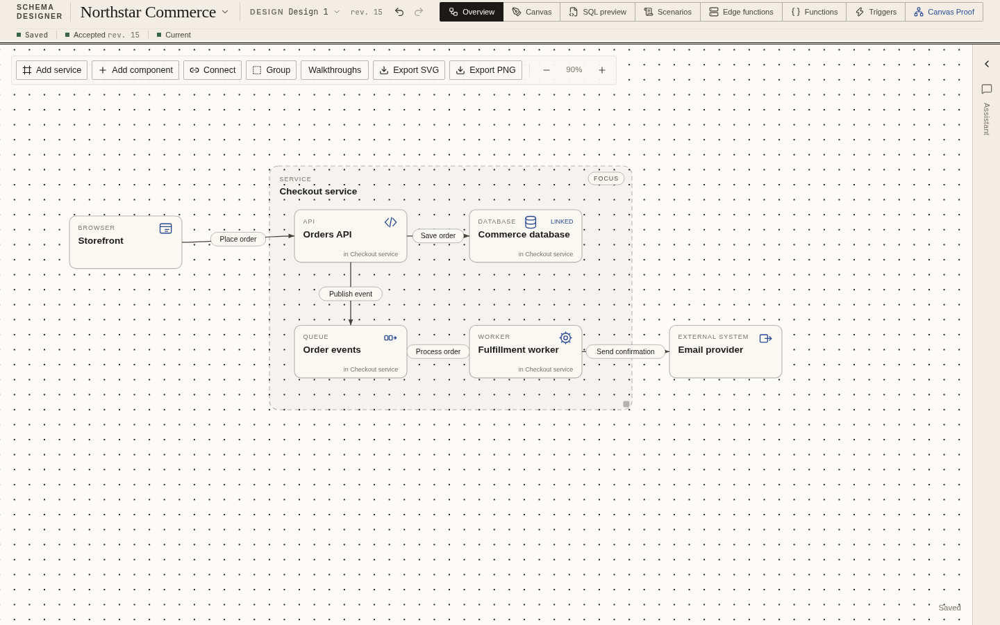
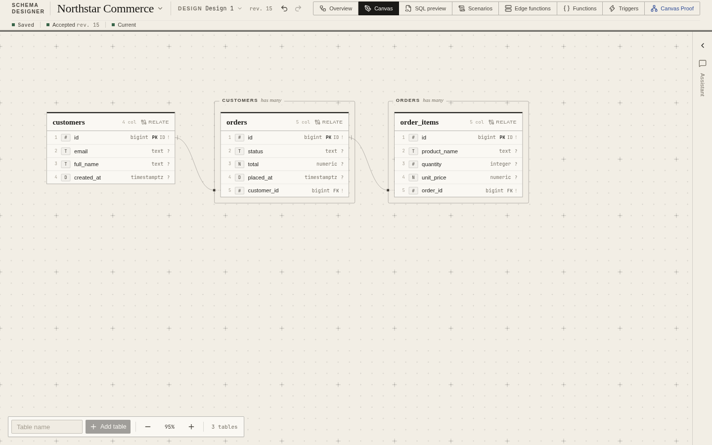
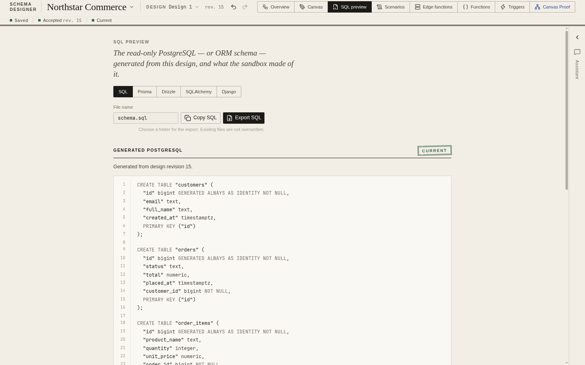

# System planner

Design a system, explore its databases, and explain how the pieces work together.
Schema Designer is a local desktop app for system architecture and PostgreSQL
schema design, built with Rust and Tauri, a React view, and an embedded PGlite
sandbox. No Docker or installed PostgreSQL server is required.



## Features

### System architecture

- Build System designs with Components, directed Connections, Services, and Groups.
- Choose from a catalog of clients, APIs, workers, databases, caches, queues,
  storage, traffic infrastructure, supporting capabilities, and custom Components.
- Assign Components to Services, collapse Service boundaries, or open a focused
  Service view without creating a separate diagram.
- Shape Connection routes with attachment sides and bend points.
- Link Database components to database Designs. Multiple Components can share one
  schema, while separate Designs keep independent schemas.
- Author named Walkthroughs with ordered steps, parallel branches, finite
  repetitions, and coordinated playback. Walkthroughs explain an interaction;
  they do not execute the system or provision infrastructure.
- Export system diagrams as SVG or PNG.

### Database design

- Arrange table cards on a canvas with pan, zoom, and saved layout.
- Edit columns, PostgreSQL types, structured defaults, primary keys, nullability,
  uniqueness, and notes.
- Create one-to-many, one-to-one, and many-to-many Relationships with real foreign
  keys and editable junction tables.
- Model enum types, indexes, composite unique constraints, row-level security
  policies, SQL Functions, and Triggers, including supported pgvector types and
  index methods.
- Preview and export PostgreSQL SQL or generated schema code for Prisma, Drizzle,
  SQLAlchemy, and Django ORM. Format-specific limitations are reported.
- Validate a valid Design in a disposable embedded PostgreSQL sandbox. An
  unfinished or invalid Design remains saved even when validation fails.



### Scenarios, Assistant, and project files

- Write TypeScript Scenarios using a Supabase-style client and run them against
  fresh, isolated Sandboxes, with expectations, request logs, and result grids.
- Author TypeScript Edge functions belonging to a database Design.
- Use the project Assistant to inspect and edit project content. Select Codex
  or OpenCode to use an installed, signed-in CLI with its own tools and
  settings, plus Project tools available only to the app's own sessions. The app
  keeps no provider keys of its own. Core editing works without an Assistant.
- Attach specifications and PDFs to a Project so the Assistant can read them as
  background for a feature.
- Autosave Projects locally in SQLite, including unfinished work and layouts.
  Undo and redo cover project content, including grouped Assistant changes.
- Export and import portable `.dbplanner.json` Project files. Exports include
  Designs, System designs, Walkthroughs, Scenarios, and Edge function source;
  provider credentials and Assistant Conversations are excluded.



The Sandbox API implements a documented subset of PostgREST. It rejects
unsupported requests rather than approximating their behavior. Sandbox data is
rebuildable preview data, not a connection to a production database.

## Install

Schema Designer is a Tauri desktop app. There are no tagged releases yet, so you either take the installer
that CI builds or build it yourself.

### Use a CI build

Every run of the *Tauri rewrite* workflow on `main` uploads one installer folder per platform. Open the
repository's **Actions** tab, pick the latest run, and download `schema-designer-ubuntu-latest`,
`schema-designer-macos-latest` or `schema-designer-windows-latest` from **Artifacts** (you need to be signed in
to GitHub; artifacts are kept for 90 days). The builds are not signed yet, so Windows SmartScreen and macOS
Gatekeeper warn about an unknown publisher; see [docs/release.md](docs/release.md).

### Install the package

Whether you downloaded it or built it (next section), the installers are in
`src-tauri/target/release/bundle/` (or `$CARGO_TARGET_DIR/release/bundle/`), one folder per format:

| System | Package | Install | Remove |
| --- | --- | --- | --- |
| Debian, Ubuntu | `deb/Schema Designer_<version>_amd64.deb` | `sudo apt install ./"Schema Designer_<version>_amd64.deb"` | `sudo apt remove schema-designer` |
| Fedora, openSUSE | `rpm/Schema Designer-<version>-1.x86_64.rpm` | `sudo dnf install ./"Schema Designer-<version>-1.x86_64.rpm"` | `sudo dnf remove schema-designer` |
| Any Linux | `appimage/Schema Designer_<version>_amd64.AppImage` | `chmod +x "<file>.AppImage" && ./"<file>.AppImage"` | delete the file |
| Windows | `nsis/Schema Designer_<version>_x64-setup.exe` or `msi/Schema Designer_<version>_x64_en-US.msi` | run it; at the SmartScreen warning choose **More info** then **Run anyway** | Settings, Apps |
| macOS | `dmg/Schema Designer_<version>_aarch64.dmg` | open it and drag the app to Applications; the first time, right-click the app and choose **Open** | delete the app |

CI builds every format listed. On your own machine you get the ones your platform supports (`cargo tauri build`
builds them all; `--bundles deb` builds one). The macOS build in CI is for Apple Silicon (`aarch64`); an Intel Mac
builds its own with the steps below. The installed Linux app is `schema-designer` on your `PATH` and in the
application menu. Your projects stay when you remove or upgrade the app (see [Local data](#local-data)).

### Build it yourself

You need Git, [Bun](https://bun.sh/docs/installation), a stable [Rust](https://rustup.rs) toolchain and the
native dependencies for your platform ([Tauri prerequisites](https://tauri.app/start/prerequisites/)): GTK 3 and
WebKitGTK 4.1 on Linux, the Visual Studio C++ build tools (WebView2 is already on Windows 10 and 11) on Windows,
Xcode's command-line tools on macOS. The first build compiles PostgreSQL's parser and the PGlite runtime, so it
takes several minutes and a few GB of memory (`CARGO_BUILD_JOBS=3` helps on small machines).

```bash
git clone https://github.com/jvasquezt2004/db-planner.git
cd db-planner
bun install
```

Bun installs the view's dependencies and builds the view in either route below. Choose how to run Tauri's
command-line tool:

**With Bun** (the tool comes from `bun install`):

```bash
bun run tauri dev      # run the app with hot reload
bun run tauri build    # build the installers
```

**With Cargo** (install the tool once, then use it as a Cargo command):

```bash
cargo install tauri-cli --version "^2" --locked
cargo tauri dev        # run the app with hot reload
cargo tauri build      # build the installers
```

Both do the same thing; the Cargo route only swaps where the Tauri tool comes from, because the view is always
built with Bun. `cargo tauri build --bundles deb` builds just one format (`deb`, `rpm`, `appimage`, `nsis`,
`msi` or `dmg`, for the platform you are on).

### Use the Assistant

To use Codex in the Assistant, install the Codex CLI, make `codex` available on
the desktop app's `PATH`, and run `codex login` in a terminal. Select **Codex
(default model)** or another listed Codex model in the Assistant. The default
option uses the CLI's configured model. The app starts Codex in the Project's folder
(`~/Schema Designer/<project>/`, a readable copy of its SQL and System design;
Codex changes the schema by editing `schema.sql` there and applying it).
Codex handles file and command
permissions; Project Revert covers Schema Designer Project changes, not files
or commands outside the app. OpenCode works the same way: install it and run
`opencode auth login`, then pick **OpenCode (default model)** or a listed model.
See [Assistant](docs/assistant.md) for details.

## First project

1. Create a named Project and open its **System overview**.
2. Use **Add component** to choose component types, add Services, and connect
   endpoints with labeled interactions.
3. Select a Database component to link an existing database Design or create a
   new one, then open its schema detail.
4. Add tables and columns on the **Database canvas**, then relate tables.
5. Open **SQL preview** to inspect generated SQL and the sandbox validation result.
6. Add Scenarios to exercise the schema, or author a Walkthrough to explain the
   system interaction.

## Documentation

Some documents describe the original product plan or earlier implementation
slices. Use the feature guides and code for current behavior; the specification
and build plan also contain planned work.

| Topic | Guides |
| --- | --- |
| Product and vocabulary | [Product spec](docs/spec.md), [glossary](GLOSSARY.md), [design principles](docs/design.md) |
| System architecture | [System design](docs/system-design.md), [component catalog](docs/system-components.md), [build plan](docs/system-design-build-plan.md) |
| Projects and layout | [Projects and autosave](docs/projects-and-autosave.md), [canvas and layout](docs/canvas-and-layout.md) |
| Schema editing | [Column editing](docs/column-editing.md), [defaults](docs/column-defaults.md), [Relationships](docs/relationships.md), [PostgreSQL features](docs/postgres-features.md) |
| Generated code | [Schema code formats](docs/schema-code.md), [Prisma](docs/schema-code-prisma.md), [Drizzle](docs/schema-code-drizzle.md), [Django](docs/schema-code-django.md) |
| Executable previews | [Sandbox API](docs/sandbox-api.md), [Scenario expectations](docs/scenario-expectations.md) |
| Assistant | [Assistant architecture and behavior](docs/assistant.md) |
| Persistence and portability | [Architecture decisions](docs/adr/), [Project export/import contract](docs/adr/0012-portable-project-export-and-import.md) |
| Packaging | [Release notes](docs/release.md) |

## Development

| Command | Purpose |
| --- | --- |
| `cd tauri && cargo tauri dev` | Run the desktop app with Vite hot reload |
| `bun run tauri build` | Build the desktop package |
| `cd src-tauri && cargo test --workspace` | Run the Rust tests, which replay the recorded behaviour in `src-tauri/fixtures` |
| `bun run test` | Run the view's tests |
| `bun run typecheck` | Check the view's TypeScript types |

### Code map

The repository is one Tauri project: the React view in `src/`, the Rust backend in `src-tauri/`.

- `src/` — the view: React views, architecture and database canvases, inspectors, code editors and the
  Assistant sidebar. `src/components/ui/` holds the shared Radix-based components and `src/index.css` the
  typography, colors and design tokens.
- `src/shared/` — domain models, component catalog, Walkthrough playback, schema code generators and the typed
  RPC contract (`rpc.ts`) the view and the backend agree on.
- `src/backend/` — the view's connection to the backend: requests and pushes over Tauri commands and events.
- `src-tauri/crates/` — the backend as Rust crates: `domain` (Designs, SQL generation, System design,
  Walkthroughs), `store` (SQLite), `workspace` (edits, history, autosave, Scenario runs), `sandbox` and
  `scenario` (PGlite), `transfer`, `files`, `folder` (Project export, files, folder), `assistant` (Codex and
  OpenCode harnesses and the Project tools).
- `src-tauri/src/` — the Tauri shell: commands, dialogs, clipboard, Project folder sync.
- `src-tauri/fixtures/` — recordings of the original TypeScript implementation's behaviour, replayed by the
  Rust tests (see its README).
- `docs/` — guides, ADRs, and the rewrite's [parity report](docs/parity.md), [release notes](docs/release.md) and
  [development notes](docs/development.md).

### Local data

The app stores its authoritative project data in `schema-designer.sqlite` in its per-user data directory
(on Linux `~/.local/share/com.dbplanner.schema-designer/`), and a readable copy of each Project in
`~/Schema Designer/`. Set `DB_PLANNER_DATABASE_PATH` and `DB_PLANNER_PROJECTS_PATH` to use other locations,
for example for demos or smoke checks. The app does not read the database of the earlier Electrobun version.

The README screenshots show the application frontend connected to an isolated
demo backend, using an illustrative commerce Project.
