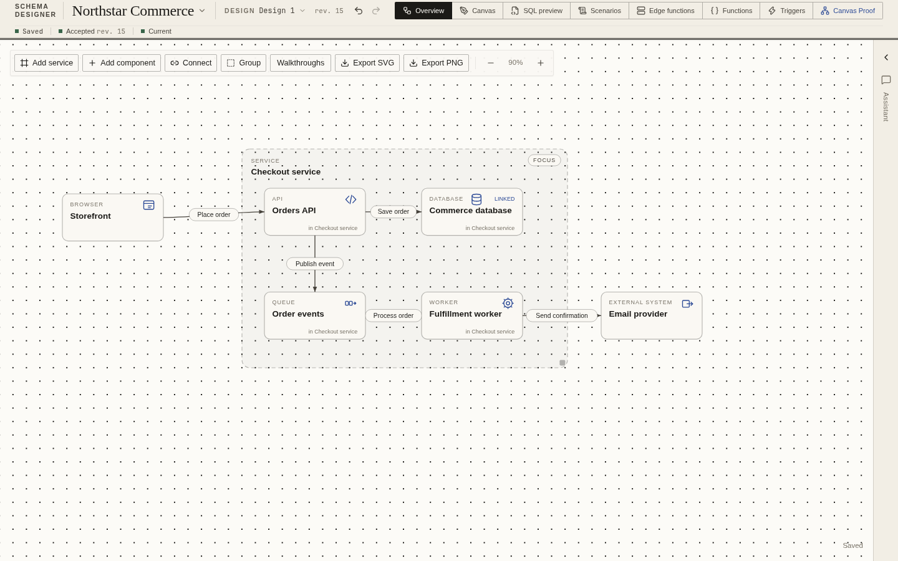
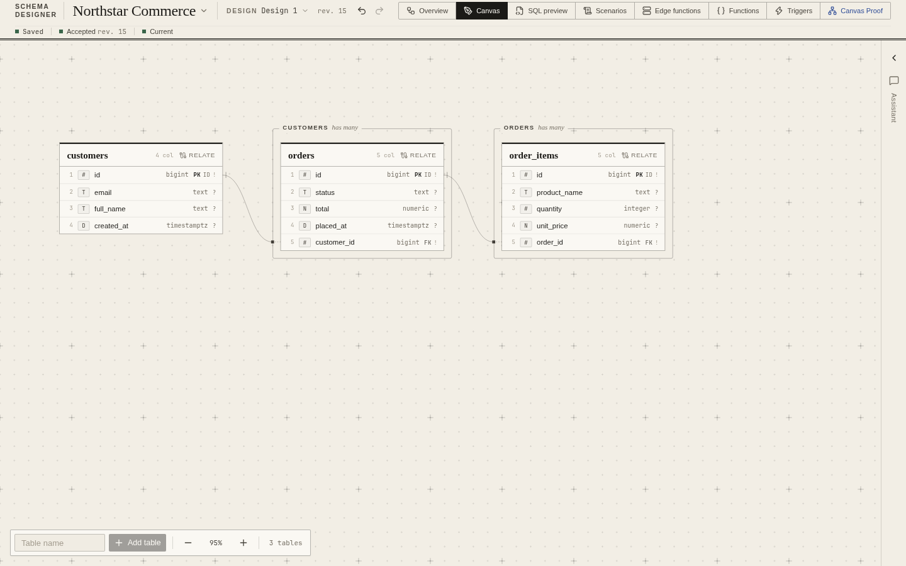
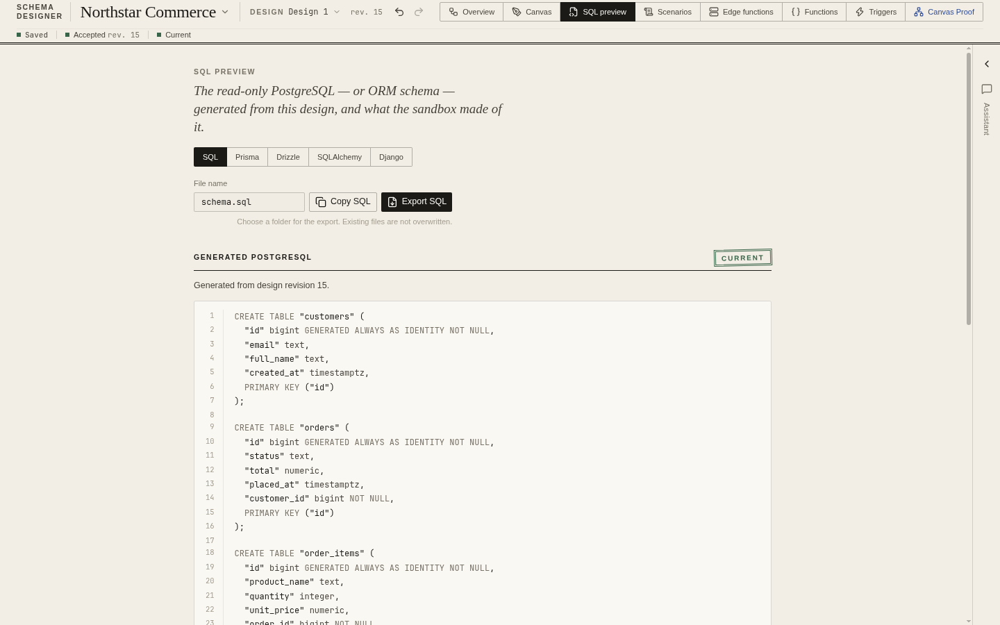

# System planner

Design a system, explore its databases, and explain how the pieces work together.
Schema Designer is a local desktop app for system architecture and PostgreSQL
schema design, built with TypeScript, React, Electrobun, and an embedded PGlite
sandbox. No Docker or installed PostgreSQL server is required.



## Features

### System architecture

- Build System designs with Components, directed Connections, Services, and Groups.
- Choose from a catalog of clients, APIs, workers, databases, caches, queues,
  storage, traffic infrastructure, supporting capabilities, and custom Components.
- Assign Components to Services, collapse Service boundaries, or open a focused
  Service view without creating a separate diagram.
- Shape Connection routes with attachment sides and bend points.
- Link Database components to database Designs. Multiple Components can share one
  schema, while separate Designs keep independent schemas.
- Author named Walkthroughs with ordered steps, parallel branches, finite
  repetitions, and coordinated playback. Walkthroughs explain an interaction;
  they do not execute the system or provision infrastructure.
- Export system diagrams as SVG or PNG.

### Database design

- Arrange table cards on a canvas with pan, zoom, and saved layout.
- Edit columns, PostgreSQL types, structured defaults, primary keys, nullability,
  uniqueness, and notes.
- Create one-to-many, one-to-one, and many-to-many Relationships with real foreign
  keys and editable junction tables.
- Model enum types, indexes, composite unique constraints, row-level security
  policies, SQL Functions, and Triggers, including supported pgvector types and
  index methods.
- Preview and export PostgreSQL SQL or generated schema code for Prisma, Drizzle,
  SQLAlchemy, and Django ORM. Format-specific limitations are reported.
- Validate a valid Design in a disposable embedded PostgreSQL sandbox. An
  unfinished or invalid Design remains saved even when validation fails.



### Scenarios, Assistant, and project files

- Write TypeScript Scenarios using a Supabase-style client and run them against
  fresh, isolated Sandboxes, with expectations, request logs, and result grids.
- Author TypeScript Edge functions belonging to a database Design.
- Use the project Assistant to inspect and edit project content, with provider
  connections, saved Conversations, and tools for design and code changes.
  Assistant use requires a configured provider connection; core editing works
  without one.
- Autosave Projects locally in SQLite, including unfinished work and layouts.
  Undo and redo cover project content, including grouped Assistant changes.
- Export and import portable `.dbplanner.json` Project files. Exports include
  Designs, System designs, Walkthroughs, Scenarios, and Edge function source;
  provider credentials and Assistant Conversations are excluded.



The Sandbox API implements a documented subset of PostgREST. It rejects
unsupported requests rather than approximating their behavior. Sandbox data is
rebuildable preview data, not a connection to a production database.

## Install and run from source

### Prerequisites

- Git.
- [Hutch](https://github.com/blackboardsh/electrobun/blob/main/docs/src/content/docs/electrobun/guides/quick-start.mdx),
  which manages the Electrobun devkit and toolchains. The repository pins its
  versions in [hutch.config.ts](hutch.config.ts).
- [Bun](https://bun.sh/docs/installation) for the test and typecheck commands below.
- The native runtime dependencies for your platform. Linux uses GTK 3,
  WebKitGTK 4.1, and an app indicator library; Windows uses WebView2.

Install Hutch on Linux or macOS:

```bash
curl -fsSL https://hutch.blackboard.sh/hutch/install.sh | sh
```

Or in Windows PowerShell:

```powershell
& ([scriptblock]::Create((irm https://hutch.blackboard.sh/hutch/install.ps1)))
```

Restart your terminal if needed, then check `hutch --version`.
See the upstream [platform dependency guide](https://github.com/blackboardsh/electrobun/blob/main/docs/src/content/docs/electrobun/guides/cross-platform-development.mdx)
for native runtime packages. The repository includes a Linux installer and
packaging checks for Linux and Windows; macOS packaging is not verified here.

### Start the app

```bash
git clone https://github.com/jvasquezt2004/db-planner.git
cd db-planner
hutch run install
hutch run dev
```

For frontend hot reload, use `hutch run dev:hmr`. The app is a desktop application;
its frontend communicates with the Bun main process through Electrobun RPC, so
opening the Vite URL alone does not provide the full application.

### Install on Linux

Install the native runtime libraries and `rsvg-convert`, which the installer uses
to render the app icons. For example, on Ubuntu/Debian:

```bash
sudo apt install libgtk-3-0 libwebkit2gtk-4.1-0 libayatana-appindicator3-1 librsvg2-bin
```

From the prepared checkout:

```bash
hutch run install:linux
schema-designer
```

The installer builds the stable app, installs its files under
`${XDG_DATA_HOME:-~/.local/share}/schema-designer`, creates the
`~/.local/bin/schema-designer` launcher, and registers a desktop entry and icons.
Ensure `~/.local/bin` is on your `PATH`, or launch **Schema Designer** from your
application menu. The current installer expects a Linux x64 build.

Run `hutch run install:linux` again to upgrade. To remove the application:

```bash
hutch run uninstall:linux
```

Upgrades and uninstalls preserve the separate user database.

### Build a distributable

```bash
hutch run build
```

Packaged output is written under `build/` for the stable channel and current
platform. On Windows, use the generated setup executable to install the app.
See the [Windows smoke-check guide](docs/packaged-windows-smoke-check.md) for
packaged verification and runtime troubleshooting.

## First project

1. Create a named Project and open its **System overview**.
2. Use **Add component** to choose component types, add Services, and connect
   endpoints with labeled interactions.
3. Select a Database component to link an existing database Design or create a
   new one, then open its schema detail.
4. Add tables and columns on the **Database canvas**, then relate tables.
5. Open **SQL preview** to inspect generated SQL and the sandbox validation result.
6. Add Scenarios to exercise the schema, or author a Walkthrough to explain the
   system interaction.

## Documentation

Some documents describe the original product plan or earlier implementation
slices. Use the feature guides and code for current behavior; the specification
and build plan also contain planned work.

| Topic | Guides |
| --- | --- |
| Product and vocabulary | [Product spec](docs/spec.md), [glossary](GLOSSARY.md), [design principles](docs/design.md) |
| System architecture | [System design](docs/system-design.md), [component catalog](docs/system-components.md), [build plan](docs/system-design-build-plan.md) |
| Projects and layout | [Projects and autosave](docs/projects-and-autosave.md), [canvas and layout](docs/canvas-and-layout.md) |
| Schema editing | [Column editing](docs/column-editing.md), [defaults](docs/column-defaults.md), [Relationships](docs/relationships.md), [PostgreSQL features](docs/postgres-features.md) |
| Generated code | [Schema code formats](docs/schema-code.md), [Prisma](docs/schema-code-prisma.md), [Drizzle](docs/schema-code-drizzle.md), [Django](docs/schema-code-django.md) |
| Executable previews | [Sandbox API](docs/sandbox-api.md), [Scenario expectations](docs/scenario-expectations.md) |
| Assistant | [Assistant architecture and behavior](docs/assistant.md) |
| Persistence and portability | [Architecture decisions](docs/adr/), [Project export/import contract](docs/adr/0012-portable-project-export-and-import.md) |
| Packaging | [Windows smoke check](docs/packaged-windows-smoke-check.md), [canvas proof evidence](docs/packaged-canvas-proof-evidence.md) |

## Development

| Command | Purpose |
| --- | --- |
| `hutch run install` | Install locked project dependencies |
| `hutch run dev` | Build the frontend and run the desktop app with main-process watching |
| `hutch run dev:hmr` | Run the desktop app with Vite hot reload |
| `hutch run build` | Build the stable desktop package |
| `hutch run build:canary` | Build a canary desktop package |
| `bun test` | Run the behavioral tests, including real SQLite and PGlite tests |
| `bunx tsc --noEmit` | Check TypeScript types |

### Code map

- `src/shared/` — domain models, component catalog, Walkthrough playback, schema
  code generators, and the typed RPC contract.
- `src/bun/` — workspace operations, SQLite persistence, SQL generation,
  sandbox orchestration, Assistant runtime, and native file exports.
- `src/mainview/` — React views, architecture and database canvases, inspectors,
  code editors, and the Assistant sidebar.
- `src/mainview/components/ui/` — shared Radix-based UI components.
- `src/mainview/index.css` — typography, colors, and UI design tokens.
- `electrobun.config.ts` — desktop packaging, native platform options, and bundled
  assets, including the PGlite and parser WebAssembly files.
- `hutch.config.ts` — pinned toolchain versions and development/build commands.

### Local data

The app stores its authoritative project data in `schema-designer.sqlite` under
Electrobun's per-user application data directory. Stable and development runs use
separate channels. On Linux the default stable database is:

```text
~/.local/share/com.dbplanner.schema-designer/stable/schema-designer.sqlite
```

On Windows it lives beneath `%LOCALAPPDATA%\com.dbplanner.schema-designer\` in
the channel's application data location. Set `DB_PLANNER_DATABASE_PATH` to use a
separate database, for example for demos or smoke checks. Provider credentials
are handled separately from portable Project files.

The README screenshots show the application frontend connected to an isolated
demo backend, using an illustrative commerce Project.
