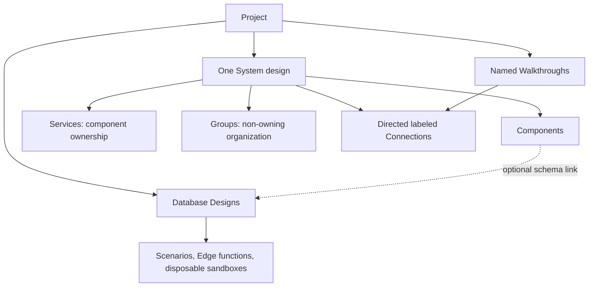

# System-design expansion build plan

This plan translates the [agreed product specification](system-design.md) into
codebase changes and reviewable checkpoints. Product behavior is agreed;
proposed module names and implementation contracts below are engineering design
to validate, not claims that the expansion exists. No application changes are
part of this planning work.

## Resulting product model

The architecture is a directed multigraph, not a database relationship diagram.
Components and Services are valid Connection endpoints. Groups organize existing
identities and are not interaction endpoints. A Service owns Components, not
other Services. A Component has zero or one Service owner; zero means system
scope. Several Database components can intentionally share one schema Design.

Preserve stable identities through rename, ownership transfer, layout changes,
and view changes. Neither Service collapse nor focused navigation creates a new
Component or rewrites a Connection. Group nesting must be acyclic; overlapping
membership is allowed. Identity uniqueness, reference shape, and cycle checks
are storage/model integrity rules, distinct from editable incomplete content.

## Codebase integration and module boundaries

| Existing seam | Planned change |
| --- | --- |
| `src/shared/design.ts` | Keep the PostgreSQL Design vocabulary; introduce explicit database Design identity and Project-level System design/Walkthrough content without turning tables into generic graph nodes. |
| `src/bun/store.ts` | Replace the one-Design-per-Project assumption with Design identity plus Project ownership; add System design and Walkthrough persistence and database-scoped code artifacts. |
| `src/bun/workspace.ts` | Preserve one public mutation boundary for manual and Assistant actions; extend validation, autosave, revision handling, history, and dependency checks across Project artifacts. |
| `src/shared/rpc.ts` and `src/bun/rpc-handlers.ts` | Carry explicit Project, Design, and artifact identity for reads, edits, runs, and asynchronous completions. |
| `src/mainview/App.tsx` | Add system overview, Service focus, Walkthrough navigation, and selected database workspace; preserve existing Assistant and database views. |
| `src/mainview/canvas.tsx` | Keep the specialized database canvas and its existing relationship notation. Add a separate architecture canvas behind the shared Project shell. |
| `src/bun/assistant-runtime.ts` | Extend scoped reads and tools for architecture and Walkthrough editing; add read-version preconditions and attributed change tracking. |
| `src/mainview/scenario-run-driver.ts` and Scenario workers | Bind runs and handler lookup to a particular database Design, independent of navigation. |
| `src/shared/scenario-types.ts` and `src/mainview/monaco-setup.ts` | Supply the selected Design's declarations without merging incompatible global Database types. |
| `src/bun/sql-preview.ts` and existing export lifecycle | Reuse native picker/cancellation and click-time snapshot patterns; add Project and diagram exporters separately from SQL generation. |

Proposed additions should have narrow responsibilities:

- System-model module: authoritative Components, Services, Groups, Connections,
  schema links, validation, and dependency-impact queries.
- Component registry: the [28 kinds](system-components.md), descriptive fields,
  icon definitions, and compatible action/reaction presets.
- Scene projection: overview/focused/collapsed presentation and endpoint mapping.
- Connection geometry: automatic routes, attachment hints, manual bend points,
  hit targets, and label placement used by both editing and playback.
- Walkthrough module: authored structure, reference checks, and review state.
- Playback compiler/controller: deterministic timeline and transport controls.
- Project change journal: actor attribution, inverse changes, relevant-version
  checks, and transactionally applied Undo/Redo/Revert.
- Portable-format module: versioned data validation and reference-preserving
  import into a new Project.

These can live in the existing shared/Bun/view layers. Module names and file
count should follow proven responsibilities rather than requiring a large
framework or a wholesale workspace rewrite up front.

## Persistence, revisions, and migration

Proposed durable records distinguish the following concerns:

| Record | Identity and content |
| --- | --- |
| Project | Project identity, name, and Project-level content ownership. |
| Database Design | Design identity, Project identity, authoritative PostgreSQL document, schema/document revisions. |
| System design | One per Project; Components, Services, Groups, Connections, and optional database Design links. |
| Walkthrough | Walkthrough identity, Project identity, authored explanation, and document revision. |
| Presentation | Saved positions/routes, per-view camera and expansion state, and last-used navigation. Presentation must not decide ownership. |
| Scenario / Edge function | Artifact identity, owning database Design identity, name, source, and revision. |

Keep database schema revisions separate from layout and explanatory content.
Moving a worker or editing a Walkthrough must not rebuild PostgreSQL sandboxes.
Maintain applied snapshots, generated types, and run staleness per Design; a
schema edit affects every architectural link to that Design but no unrelated
Design. A Scenario run identifies its Project, Design, source revisions, and
applied schema snapshot throughout its lifetime.

Migration must be transactional and preserve existing saved content:

1. Give each existing Project's sole Design a stable Design identity.
2. Preserve table/column/relationship IDs, schema content, positions, revisions,
   Scenario and Edge function source, and conversations.
3. Associate existing executable artifacts with that original Design.
4. Create a System design containing one system-scope Database component linked
   to it. Do not invent Services, interactions, or Walkthroughs.
5. Retain the existing database workspace as the initial migrated view. New
   Projects begin at the system overview; subsequent opens restore saved context.
6. On migration failure, leave the original data usable; never accept a partially
   converted Project or silently replace an unfinished draft with sandbox state.

Late saves, diagnostics, run completions, and Assistant messages must retain
their original Project/Design identity so navigation cannot redirect them.
Retain the current session-only history lifetime unless separately expanded;
durable content and conversations must not imply durable rollback checkpoints.

## Architecture scene and routing

Keep domain ownership, Group membership, and visible geometry independent.
Use stable world geometry plus an explicit projection for focused or collapsed
views; the exact coordinate representation belongs to the canvas proof.

- Overview and Service focus render the same identities. Focus retains external
  endpoint context without copying external resources into the Service.
- Expanded Service boundaries frame their owned Components; collapsed Services
  have visible endpoints and summarize internal playback activity.
- A projected edge retains its original Connection ID, actual endpoints, and
  visible endpoints. Collapse does not merge distinct Connections into one
  authoritative edge. Multiple Connections remain selectable/explainable.
- A service-level Connection stays service-level when expanded. It does not
  infer a target API, worker, or internal chain.
- Groups may span Service ownership and overlap. Membership is explicit;
  resizing a frame is a layout edit. Dragging nested/overlapping memberships
  resolves the affected identities first and moves each once.
- Automatic routing and optional attachment-side/bend-point adjustments produce
  one path description used by painting, hit-testing, labels, and message motion.
- Layout changes preserve authored durations. If a path becomes longer, playback
  still reaches the destination at its authored arrival time.

Service removal releases Components to system scope. Group removal keeps its
members. Database-component removal leaves its Design and executable content.
Impact queries must identify affected Connections and Walkthrough steps before
destructive operations. Dangling Walkthrough references remain repairable
content rather than being silently rerouted or erased.

## Canvas and SVG technical proof

React Flow is a candidate editor layer; extending the custom canvas remains an
alternative. Neither choice changes the authoritative model. Current official
documentation supports custom React nodes, SVG edge paths, and animated objects
along those paths, but does not prove this application's native compatibility.
See [custom nodes](https://reactflow.dev/learn/customization/custom-nodes),
[custom edges](https://reactflow.dev/learn/customization/custom-edges), and
[edge animation examples](https://reactflow.dev/examples/edges/animating-edges).

Two documented constraints need explicit proof:

- React Flow's single `parentId` describes positioning/movement. It cannot be
  the authority for Service ownership plus independently overlapping Groups.
  Use an adapter and overlays where appropriate.
  [Node API](https://reactflow.dev/api-reference/types/node),
  [subflows](https://reactflow.dev/learn/layouting/sub-flows).
- Its `addEdge()` helper suppresses equal source/target/handle combinations even
  when IDs differ. Approved parallel Connections need domain-controlled creation.
  [addEdge reference](https://reactflow.dev/api-reference/utils/add-edge).

The proof must run in packaged Windows and Linux apps, without relying on Vite
or a browser-only demonstration. Current source uses Electrobun/Bun and native
WebViews, and the existing recorded packaged smoke evidence is Windows-specific.
Test SVG animation, fonts, pointer interaction, pause/seek, and image export in
the actual shipped runtime. Choose the library and document its trade-offs only
after these checks; do not add an accepted technology ADR prematurely.

## Authored Walkthroughs and deterministic playback

Proposed authored structure uses sequences, explicit parallel groups, and finite
repetitions around interaction steps. A step refers to an existing Connection
and carries explanation, optional example message/payload, shared actions, an
optional operation preset, and illustrative phase durations. Exact field names
are a tool/storage implementation detail.

Compile a valid Walkthrough into a timeline for one topology revision. Sequential
blocks advance after their children; parallel blocks finish after all authored
branches; repetitions are finite. Bound compilation work without executing user
service code. There is no runtime condition evaluation, spontaneous retry,
queue-depth calculation, or network call hidden in playback.

Derive each frame from the current time and visible scene rather than relying
on side effects from previously fired callbacks. This makes seeking backwards,
selecting a step, pause/resume, speed changes, and repetitions consistent.

- Activate sender, move a message along the actual path, react at arrival, and
  show optional authored processing/completion/failure phases.
- Standard actions are send, receive, process, succeed, and fail. Type-specific
  presets interpret actions visually; they do not implement infrastructure.
- Parallel arrivals can produce multiple active reactions. Derive and compose
  those reactions from the timeline; do not let independent icon loops decide
  activity or leave stale state after Restart.
- Geometry changes and Service expansion update the presentation of the same
  authored time. Internal collapsed activity uses Service highlights and step
  explanations without fabricating edges.
- Structural/Walkthrough changes stop playback; renames/layout changes preserve
  references. Removed or redirected references identify repair/review needs.
  Play validates the current referenced content before starting, including any
  unresolved redirection review. Retaining a Connection ID is not sufficient if
  its endpoints changed: accept that route as intended or repair the affected
  step before playing it.
- Controls include Play/Pause, Previous/Next step, Restart, step selection,
  speed, and optional camera following. Reduced-motion presentation conveys
  the same explanation without traveling particles.

Browser APIs expose [animation seeking](https://developer.mozilla.org/en-US/docs/Web/API/Animation/currentTime)
and [SVG path sampling](https://developer.mozilla.org/en-US/docs/Web/API/SVGGeometryElement/getPointAtLength).
A shared timeline controller is the proposed application architecture; those
APIs alone do not provide the Walkthrough model or scheduler.

## Manual editing, Assistant tools, and history

Keep database SQL input from ADR-0003, now with explicit Design targeting.
Architecture and Walkthrough changes need structured edits, not SQL or renderer
source. Both manual and Assistant actions enter the same workspace validation
and persistence boundary.

Proposed tools extend the existing small tool set:

| Capability | Proposed tool behavior |
| --- | --- |
| Read Project | Return scoped model content, stable IDs, relevant versions, and diagnostics; allow focused reads rather than every artifact on every turn. |
| Edit System design | Batch Component/Service/Group/Connection/schema-link/layout operations through validated workspace changes; no tool per component kind. |
| Manage Walkthroughs | Create/revise named authored structures with stable references and explain repair/review failures. |
| Apply DDL | Target a named Design ID, preserve schema identities, and require the relevant read-version precondition. |
| Manage executable source | Target Design and code-artifact IDs with relevant-version checks. |
| Run Scenarios | Target the owning Design and Scenario explicitly; no implicit current-view database selection. |

Record attributed before/after changes and read/write dependencies for each
committed mutation. Include dependency checks for deletions and newly introduced
references, not just the fields the command writes. A stale relevant read
requires an Assistant reread/replan; unrelated edits must not create a global
Project-wide conflict.

Current Assistant tools apply live, and stopped turns retain committed changes.
Preserve useful live editing behavior while grouping an Assistant turn as one
history action. The existing Design-only Undo already rebases some intervening
manual changes; extend this with explicit conflict results across all artifacts.
The technical proof must cover active-turn Undo/Stop and interleaved edits before
locking a grouping implementation.

Current Revert uses whole start/end snapshots and sequential restores. That is
insufficient: manual edits during a turn can enter the snapshot difference,
independent edits afterwards block Revert, and sequential restore can partially
apply. Replace this mechanism with Assistant-attributed inverse changes:

1. Collect all changes belonging to the selected turn, excluding manual edits.
2. Validate their inverse against relevant current values and dependencies.
3. If later work conflicts, explain affected identities and change nothing.
4. Otherwise commit the complete inverse across artifacts in one transaction,
   then publish the new state and refresh derived previews.
5. Failed persistence cannot leave a partly reverted Project or a success label.

Ordinary content Undo/Redo uses the same change model. Drags and typing form
useful groups; camera, selection, and navigation are outside history. Surface
the next action's name. Do not claim crash/restart rollback that session-only
history cannot deliver.

## Portable Projects, diagram exports, and offline delivery

Use a versioned portable document containing architecture, database Designs,
Scenarios/Edge-function source, Walkthroughs, and layout. Exclude provider
credentials and conversation history. Import validates the format and all
structural identity constraints before atomically creating a new Project;
preserve internal Shared schema relationships. Distinguish malformed structure
from intentionally repairable draft references: missing Walkthrough Connection
references and redirection-review state must survive round-trip with their
diagnostics, rather than making an unfinished Project impossible to import.
Import does not require every Walkthrough to be playable and does not execute
source.

Static SVG/PNG export captures an immutable, explicitly selected diagram view,
with readable labels and bundled vector artwork. Reuse native picker and
cancellation patterns; snapshot at export time so later edits cannot change an
in-progress export. Validate PNG output in packaged native WebViews, including
fonts and unavailable external resources.

Bundle all editor/playback assets needed for offline operation. Preserve the
current Docker-free local database-preview baseline. Assistant model-provider
network requests remain separate from core designing/saving/playback. Animated
HTML export, hosted editing, sync/collaboration, macOS verification, behavioral
simulation, and cross-database execution are deferred.

## Checkpoints and acceptance evidence

| Checkpoint | Required outcome and evidence |
| --- | --- |
| 1. Technical proof | Demonstrate overlapping/nested Groups independent of ownership, duplicate-endpoint Connections, Service collapse/focus, SVG arrival reactions, pause/seek/speed, and export feasibility in actual packaged Windows/Linux runtimes. Exercise concurrent manual/Assistant changes and complete-turn reversal on a small fixture. Record measured behavior and a canvas-library decision. |
| 2. Architecture foundation | Migrate a legacy Project without losing content; create/edit Services, Components, Connections and database links manually and through the Assistant; save/reopen offline; keep the existing schema editor usable. Introduce the shared change/history foundation here rather than postponing data integrity. |
| 3. Complete editor | Cover all 28 kinds, explicit Group membership/movement, Shared schemas, collapsed/focused context, automatic/manual routes, named Project-wide Undo and conflict-safe Revert. |
| 4. Walkthroughs | Author multiple explanations manually and through the Assistant; demonstrate sequences, parallel work, finite retries, message payload explanations, component presets, broken-reference repair, transport controls, and reduced-motion presentation. |
| 5. Portability/release | Round-trip editable Projects and Shared schema links; verify imports preserve existing Projects; inspect SVG/PNG; repeat migration and save/reopen checks in packaged Windows/Linux builds. |

Use the same end-to-end fixture throughout: an image-upload system with client,
API, queue, worker, bucket, database, and telemetry. Include a second database
Design, a replica sharing one Design, two distinct Connections between the same
endpoints, an abstract Service-to-Service interaction, overlapping Groups, a
parallel completion step, and a finite retry explanation.

Meaningful checks should cover:

- Legacy migration with incomplete schemas, saved code, layout, and conversations.
- Identity preservation across rename, collapse, focus, ownership transfer,
  import, and Shared schema edits.
- Per-Design Scenario isolation, handler namespace/type context, staleness, and
  late completions after navigation.
- Missing-reference repair and redirect review without silent story changes.
- Deterministic seek/parallel/repeat behavior and arrival timing after layout edits.
- Group movement deduplication and removal preserving member content.
- Revert preserving manual edits made both during and after a turn, independent
  edits not blocking, dependency conflicts, and all-or-nothing persistence failure.
- Offline save/reopen/playback, packaged asset resolution, native export, keyboard
  access, reduced motion, and narrow-window panel competition.

These are acceptance targets, not tests already run. Use behavioral tests at
workspace/persistence/playback boundaries and packaged visual/interaction checks
where runtime rendering is the evidence required. Expand testing when changes
or failures justify it; avoid tests that merely repeat implementation structure.
